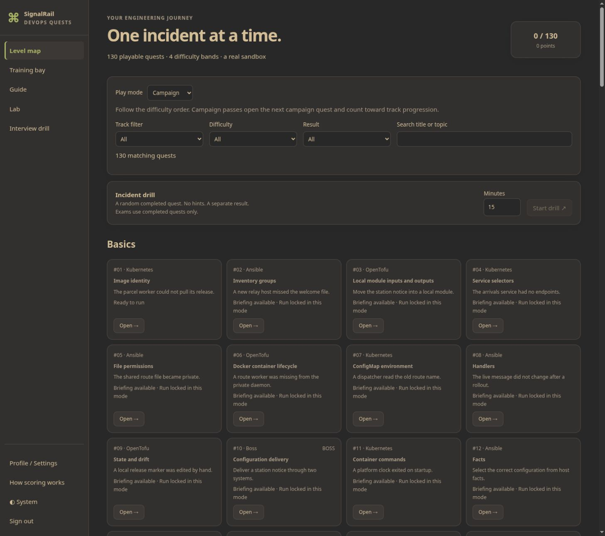
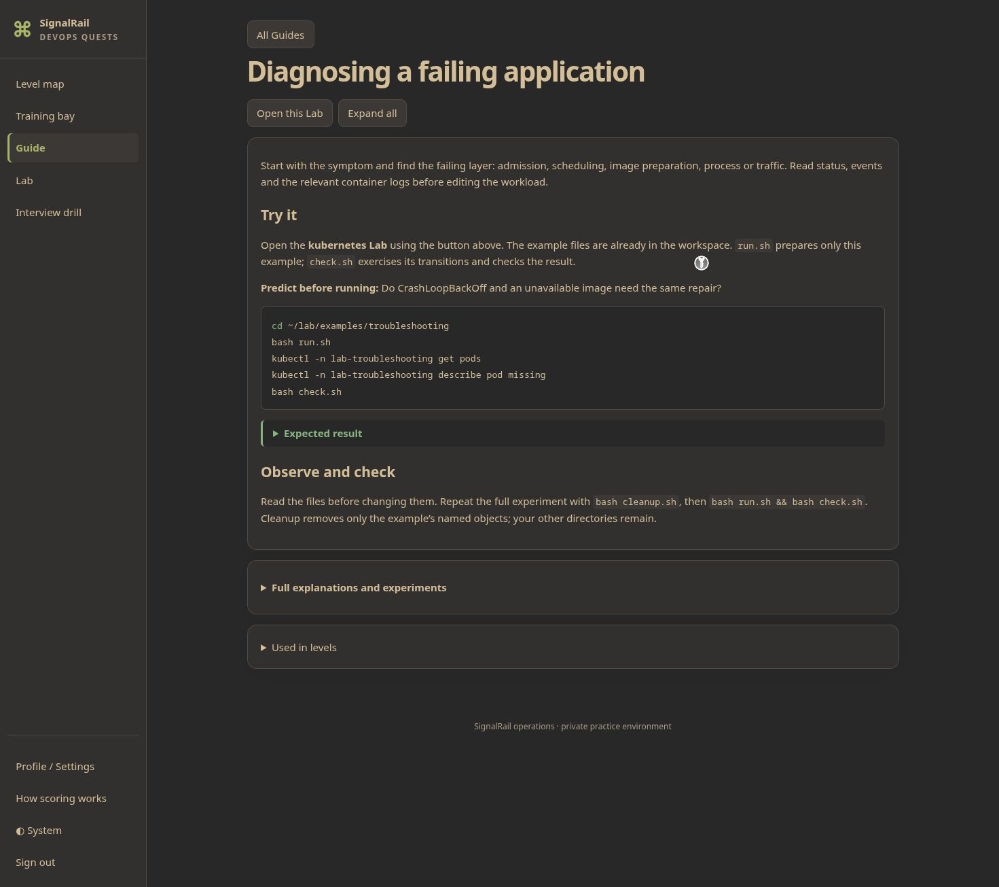

# DevOps Quests

A self-hosted hobby project for hands-on DevOps incident practice: 130 quests,
29 bilingual Guides, an Interview drill, and five persistent Lab profiles.
The backend creates real, isolated Docker/kind environments. No cloud account is required.

**Web terminal = remote shell inside sandboxes. Run only locally or on a trusted
network behind TLS and authentication.** The trusted backend controls Docker and
therefore has host-administrator privileges. This is not a public multi-tenant service.
There is no default account or password.

Screenshots from a clean Linux installation with a synthetic `demo` account:




Solutions included — CI uses them to prove every level is solvable. Default public
CI checks solution/content contracts; real sandbox execution is opt-in and runs only
the levels affected by a change. The complete solution set lives in `solutions/`.

## Requirements

- Native Linux x86_64, Docker Engine, Docker Compose v2 and a working cgroup v2 host.
- 4 vCPU / 8 GB RAM minimum for the complete curriculum; leave host headroom.
- At least 40 GB free disk for images, build cache and persistent Lab data; 60 GB is
  more comfortable. The first source install on clean Ubuntu used 4.81 GB of Docker
  images, 0.70 GB of offline asset files and a 1.14 GB kind volume after level 1.
  Allow several GB of network downloads; OS packages, tools and build dependencies
  add traffic beyond image layers. Exact GHCR transfer size is release dependent.
- Nested containers and privileged kind nodes must be permitted. The learner's
  workstation is non-root and has no host Docker socket. Only the backend controls it.
- amd64 only. macOS/Windows Docker Desktop are **not supported**: host-network firewall
  helpers require access to the Linux engine's network namespace. These platforms
  have not been qualified; use a Linux VM instead.

Reference measurements on a Linux guest with 4 vCPU / 8 GiB and a 6 GiB / 3 CPU
application budget, running one profile at a time:

| Profile | Topology | Sampled application memory peak |
| --- | --- | ---: |
| Kubernetes | private three-node kind cluster + workstation | 4.46 GiB |
| Ansible | controller + three SSH targets | 2.51 GiB |
| OpenTofu | local providers, state and private nested Docker | 2.97 GiB |
| Helm | private cluster, local charts and volumes | 4.78 GiB |
| GitOps | private cluster, Gitea and Argo CD | 5.37 GiB |

These measurements cover the supplied examples, not arbitrary additional workloads.
Cold Kubernetes/GitOps preparation can take 10–15 minutes. Source image builds can
need substantially more time and temporary disk than pulling published artifacts.
A clean Ubuntu 24.04 source installation reached an authenticated app within 5m14s
after its OS prerequisites were installed, on the test connection. This is an observed
upper bound for that run, not a promised installation time; cluster preparation is separate.

## Quick start

Download a tagged release and verify its `SHA256SUMS` as described in
[RELEASING.md](docs/RELEASING.md). From its extracted directory, on Linux:

```sh
docker compose up --build
```

The backend listens on **127.0.0.1:8766**. It does not create a user automatically.
In another terminal, explicitly create the first administrator:

```sh
docker compose exec app python -m devops_quests init-admin --username demo
```

Enter your own password at the hidden prompt (12–128 characters), then sign in at
<http://127.0.0.1:8766/>. `config.example.env` documents optional first-start environment
variables; populated `.env` files are ignored by Git. Never put passwords in shell history.

Before the first public release is published, contributors can use `make up` to build
pinned local assets, or supply a verified local release image bundle for installation
tests. No GitHub publication is required for source builds.

## Source installation

Python 3.12+, Node.js 22+, Go and Docker are required to build all offline assets.

```sh
make install
make up
.venv/bin/python -m devops_quests init-admin --username demo
```

`make up` prepares checksum-verified tools and immutable images before starting the
loopback server. Subsequent starts reuse those assets. Never run the app as an untrusted
host user: Docker access is administrative access.

[cloud-init.example.yaml](deploy/cloud-init.example.yaml) prepares a fresh Ubuntu VM
and starts a verified tagged release with Compose. Supply your own SSH key through the
VM manager. Reach the loopback app with SSH forwarding, then create the first app admin
explicitly; the VM example contains no app credentials.

## Data, backup and removal

Default state is `.state/runtime/`: `progress.db` holds accounts, progress, saved Lab
records and pending briefing hints. `.state/runtime/labs/<id>/` holds ownership journals
and client files. Lab workspaces/target changes also live in owned containers and Docker
volumes; stopping saves them, deleting a Lab removes them. Processes and PTYs do not
survive Stop/Continue.

A database-only backup is not a complete Lab backup. Stop every Lab and the application,
copy `.state/`, then preserve the owned container writable layers and named volumes if
workspace/target changes are needed. See [LABS.md](docs/LABS.md) for the scope. Keep
backups outside the source tree and test restoration before relying on them.

`docker compose down` stops the backend and preserves data. Delete Labs through the UI
first; `reset` removes only Training Bay resources, not saved Labs. After confirming that
no saved data is needed, remove this installation's `.state/` and image cache. Do not use
global Docker prune commands: another installation may share the daemon.

Updates use a new immutable tag and verified assets. Stop active attempts/Labs and resolve
pending briefing hints first, back up all persistent data, and follow the rollback checks
in [RELEASING.md](docs/RELEASING.md). Keep the old release and images until restoration is
verified. Saved Labs pin their runtime asset version; incompatible versions fail closed.

## Contributing and design

- [Architecture](docs/ARCHITECTURE.md), [contribution guide](CONTRIBUTING.md),
  [security reporting](SECURITY.md), [release rules](docs/RELEASING.md).
- Guides retain short core examples and complete references; screenshots use a synthetic
  account named `demo`. No owner accounts, databases or personal infrastructure are shipped.
- Interface and learning content are English/Russian. Other languages are outside this release.

Licensed under Apache-2.0. Third-party notices and the companion examples' MIT notice
are retained in [THIRD_PARTY_NOTICES.md](THIRD_PARTY_NOTICES.md). No book prose, questions
or illustrations are redistributed. There is no support or availability SLA.
