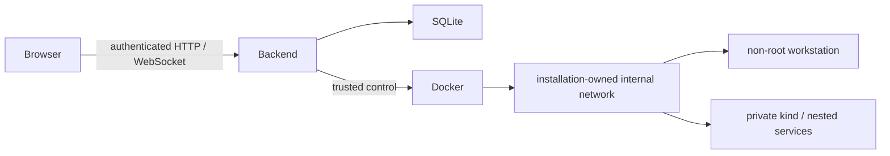

# Architecture

The aiohttp backend serves the local UI, authenticates users, enforces CSRF/origin checks,
and stores progress and ownership records in SQLite. It is trusted host infrastructure:
its Docker access is equivalent to administrator access. Learner terminals do not receive
that socket or host credentials.

`Engine` manages quest attempts; `LabManager` manages persistent workspaces. They share a
compute-slot gate. Each runtime has installation-scoped names, labels and journals; cleanup
checks exact ownership before deletion. Internal Docker bridges and per-installation firewall
helpers deny Internet, host and other bridge access without any deployment-specific firewall.
Host hardening can add further restrictions, but is not the primary sandbox boundary.

The curriculum catalog joins stable level IDs, original bilingual narrative, Guide snapshots
and examples. The UI keeps one PTY across Guide navigation; Stop/Continue creates a new process
while retaining files. All application/cluster images are prepared before offline use.

The Git source, generated web bundles and immutable image manifests form a release. Installed
Python distributions carry curriculum resources under `share/devops-quests`; source checkouts
use their own root. State and images are not included in Git or Python wheels.
