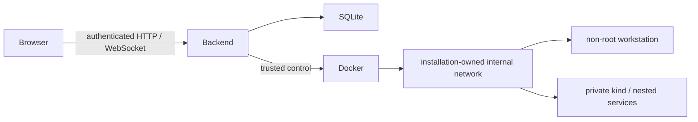

# Architecture

The aiohttp backend serves the local UI, authenticates users, enforces CSRF/origin checks,
and stores progress and ownership records in SQLite. It is trusted host infrastructure:
its Docker access is equivalent to administrator access. Learner terminals do not receive
that socket or host credentials.

## Runtime and ownership

`Engine` manages quest attempts; `LabManager` manages persistent workspaces. They share a
compute-slot gate. Each runtime has installation-scoped names, labels and journals; cleanup
checks exact ownership before deletion. Quests select kind, private nested Docker or
SSH-target topologies according to their dependencies.

## Network boundary

Internal Docker bridges and per-installation firewall
helpers deny Internet, host and other bridge access without any deployment-specific firewall.
Host hardening can add further restrictions, but is not the primary sandbox boundary.

## Goal checks

The server runs each stage's scoped check scripts against its real environment. Their
exit status determines whether its objectives pass; checks must validate the resulting
state rather than command history. See [the engine](../devops_quests/engine.py) and
[level contribution rules](../CONTRIBUTING.md).

The curriculum catalog joins stable level IDs, original bilingual narrative, Guide snapshots
and examples. The UI keeps one PTY across Guide navigation; Stop/Continue creates a new process
while retaining files. All application/cluster images are prepared before offline use.

## Release identity

The Git source, generated web bundles and immutable image manifests form a release. Installed
Python distributions carry curriculum resources under `share/devops-quests`; source checkouts
use their own root. State and images are not included in Git or Python wheels.

Release tags produce `SHA256SUMS`, a per-file source/exec manifest and a source-bound
GHCR digest lock. See [release rules](RELEASING.md) and the
[tag workflow](../.github/workflows/release.yml).

## Upgrades and recovery

The public repository defines the [upgrade/rollback contract](RELEASING.md#upgrade-and-rollback-contract);
host-specific deployment operators are maintained separately. The qualified private
integration uses an edge write gate, SQLite backups, migration rehearsals, progress
hashes and a durable recovery journal. It can return to the previous release before
traffic reopens; recovery after that point preserves the committed live database.
These operator scripts are not part of the public installer.

## Verification

[Default CI](../.github/workflows/ci.yml) runs Python and JS tests, lint, bilingual
content/diagram validators, bundle checksums, packaging and public-tree hygiene.
It starts no sandboxes. [Reference solutions](../solutions/) feed the
[opt-in integration matrix](../tests/test_quests.py), which runs solutions against
real goal checks on an isolated Linux host. Level changes require the affected
matrix; see [CONTRIBUTING.md](../CONTRIBUTING.md).

## Qualification

Native source and Compose installation paths were checked on separate disposable
Ubuntu 24.04 LTS VMs, each with 4 vCPU, 8 GiB RAM and a 60 GiB disk. Both passed
level 1 using synthetic accounts. Isolation probes confirmed non-root workstations,
no host Docker socket, allowed namespace access and blocked external DNS/TCP and
host-listener access, with positive controls outside the sandbox. Pre-publication
Compose qualification used verified local image IDs; published installs use the
release digest lock. This is Linux amd64 qualification, not a portability or
performance guarantee. [Installation measurements](INSTALL.md#requirements).
